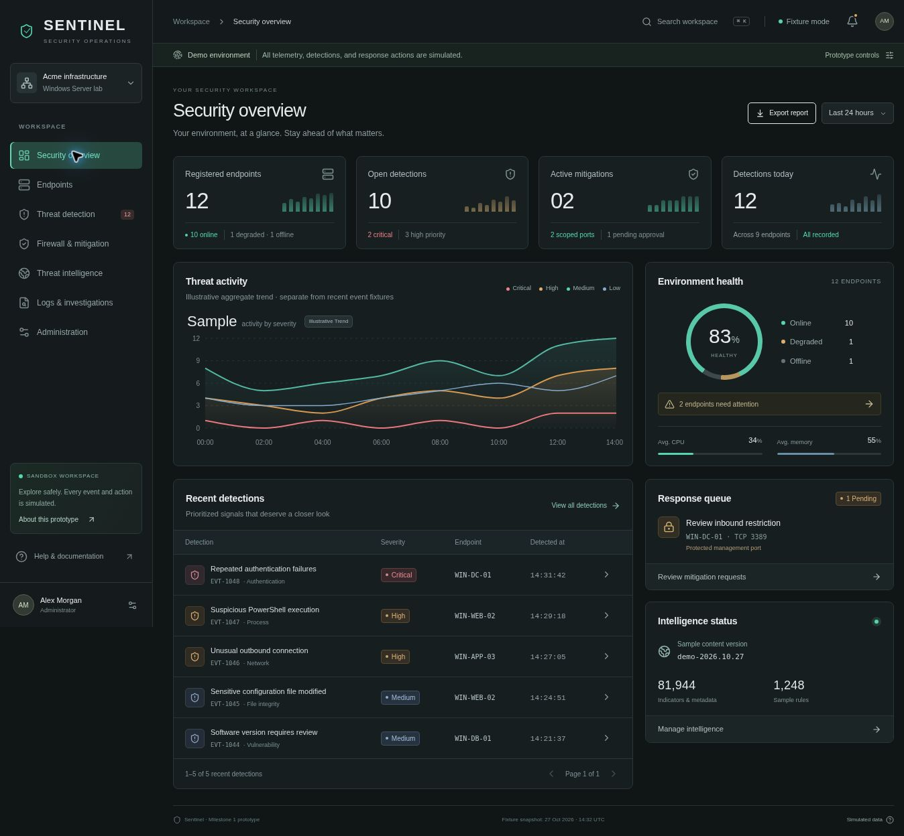

# Sentinel · Real-Time Threat Detection

A modular, Windows-first security operations platform built in six reviewable milestones.

**Current branch: Milestone 3, Windows monitoring agent.** `/` retains the labelled simulated frontend; `/live` displays authenticated backend records, agent inventory, collector health, event context and provenance. The .NET 10 agent provides native Windows collectors, protected offline buffering and controlled service installation. Intelligence updates and firewall enforcement remain later milestones.

Build and install the agent using [agent instructions](agent/README.md). Review [Milestone 3 validation and limitations](docs/MILESTONE-3.md) before deployment. Native Windows acceptance is recorded separately from Linux compilation and protocol tests.



## Run the backend and dashboard

Use branch **`milestone-3-windows-agent`** for the agent-compatible backend. On Windows, configure a local PostgreSQL database and install Python 3.12, then double-click **`start-platform.bat`**. Complete the first-administrator setup in the backend window and sign in at **http://127.0.0.1:3000/live**. The launchers install the pinned project requirements when needed. They do not create a PostgreSQL service automatically.

See [backend setup and API guide](backend/README.md), [Milestone 2 acceptance](docs/MILESTONE-2.md), and the [branch plan](docs/MILESTONE-BRANCHES.md). No default administrator password is supplied. The original `start-dashboard.bat` continues to open the simulated frontend; `start-dashboard.bat --connected` opens the connected workspace when the backend is already running.

## Windows: frontend-only launcher

Download and extract the **complete repository**, then double-click **`start-dashboard.bat`** in the project root. Keep it beside `package.json` and the `scripts` folder.

The launcher checks for Node.js 22.13+ and npm. If they are unavailable or outdated, it attempts to install Node.js LTS through Windows Package Manager. Windows may ask for installer approval or terms; if WinGet is unavailable, it shows the official Node.js installation link. No PowerShell execution-policy changes are needed.

It then obtains the pinned pnpm version using npm, installs the locked dependencies when needed, starts standard Next.js on **http://127.0.0.1:3000**, and opens the browser once the server responds. Internet access is required for first setup or changed dependencies. Later runs reuse the installed packages. Keep the terminal open; press **Ctrl+C** to stop.

Optional commands from a terminal in the repository folder:

```bat
start-dashboard.bat --reinstall
start-dashboard.bat --port=3001
start-dashboard.bat --no-open
start-dashboard.bat --setup-only
```

Use `--reinstall` to repair dependencies and `--port=3001` if port 3000 is already in use. Changed dependency files, Node versions, platforms or architectures trigger setup again. Spaces in the extracted folder path are supported. This launcher starts only the Milestone 1 frontend with simulated data.

The Node helper and setup decisions have automated coverage. Native `.bat` execution, WinGet installation and browser opening still need a Windows smoke test; development here runs on Linux.

## Run locally

Use Node.js 22.13 or later and pnpm 11.25.0:

```bash
corepack enable
pnpm install --frozen-lockfile
pnpm dev
```

For npm users, `npm install` followed by `npm run dev` is also possible, but pnpm and the committed lockfile are the reproducible path. The development scripts use the supplied Sites Next-compatible Vinext runtime. For the standard Next runtime:

```bash
pnpm dev:next
pnpm build:next
```

Sites preview/deployment uses the supplied build integration. Both the standard Next.js build and the Sites build were verified.

## Validate

```bash
pnpm typecheck
pnpm test
pnpm build
```

The automated suite checks filters, request validation, protected ports, role restrictions, state transitions, and safe CSV encoding. Browser QA and known limitations are recorded in [Milestone 1](docs/MILESTONE-1.md).

## Explore

- `/` — summary metrics, severity trends, endpoint health, recent detections and response queue.
- `/endpoints` — inventory search, status filters, sorting, pagination, resource details and histories.
- `/threats` — severity cards, filters, evidence, confidence, related alerts and investigation status.
- `/mitigation` — bounded request forms, duplicate prevention, approvals, rejections, retries, unblocks and audit details.
- `/intelligence` — source provenance, sample versions, update/failure previews, scheduling and rollback configuration.
- `/logs` — event explorer, source/time filters, evidence and administrator CSV exports.
- `/administration` — users, role matrix, enrollment preview, revocation, policies and audit records.

Use **Prototype controls** to switch administrator/analyst personas or preview loading, empty, error and disconnected states. Ctrl/Cmd+K opens global search. All demo changes live in memory across route navigation and reset on reload. No invitation email is sent and no credential is generated.

## Structure and integration

Read [Architecture](docs/ARCHITECTURE.md), [API integration](docs/API-INTEGRATION.md) and the [Original specification](docs/MASTER-PROMPT.md). Shared components are in `components/soc`; pure domain guards are in `lib/domain.ts`; the proposed typed API and realtime contracts are in `lib/types.ts`.

## Milestones

| Milestone | Scope | Status |
| --- | --- | --- |
| 1 | Frontend dashboard and UX | Complete on `milestone-1-frontend` |
| 2 | Backend, authentication, enrollment | Implemented and tested on its named branch; awaiting review |
| 3 | Windows service agent | Not started |
| 4 | Intelligence and vulnerability integrations | Not started |
| 5 | Authenticated firewall response | Not started |
| 6 | Integration, hardening and release | Not started |

Each milestone is committed independently. Stop for review before starting the next milestone, as required by the supplied specification.

## Dependency notes

The supplied lockfile pins Next 16.3.4, React 19.2.6, TypeScript 5.9.3, Tailwind 4.2.1, Recharts 3.8.0, Lucide 1.31.0 and Radix UI 1.6.7. Sites uses Vinext 1.0.0-beta.5; this runtime adapter remains a beta dependency. Milestone 2 adds TanStack Query 5.104.5 for authenticated resources. Backend versions are pinned in `backend/requirements.lock`.
